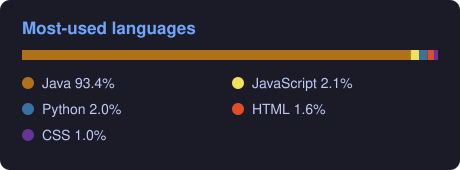

<!-- Divesh Agarwal · GitHub profile · v2026.11.04.01 -->

  

  

  
  
  
  
  
  

---

### 👋 About me

- ⚡ **Electrical engineer turned builder** — B.Tech EE (AKTU, 2018), now writing code every day.
- 🚀 **Co-founder of [SoLifeIN](https://solifein.com)** — brands, Shopify stores, content and ads for Indian D2C brands.
- 📚 **Author** of *Trust In Love* (2019) and *Why Her?* (2022) — more books on the way.
- 🏋️ Fitness, travel and Indian heritage keep me curious.
- 🌱 **Learning in public:** one concept a day, pushed here — Java now, then Git, Python, TypeScript, React, AI apps.

### 🔥 Building right now

| Project | What it is | Status |
| --- | --- | --- |
| ☕ [**java-daily-challenge**](https://github.com/idiveshagarwal/java-daily-challenge) | 60 days of Java — one concept, code + notes, every day |  |
| 🔔 [**reminders-bot → Yaad**](https://github.com/idiveshagarwal/reminders-bot) | Reminders + habits with streaks & heatmaps — Telegram today, Play Store next |  |
| 🌐 **diveshagarwal.com** | Books, writing, journeys and work — all in one place |  |

### 🧰 Tech I use

  

**Learning next →** 

<b>🗺️ My 2026–27 learning roadmap (click)</b>

`Java` → `Git & GitHub` → `Python` → `C` → `C++` → `HTML & CSS` → `JavaScript` → `TypeScript` → `Node.js` → `React` → `Next.js` → `SQL` → `AI apps (LLMs, RAG, agents)` → `Docker` → `Rust`

Every track gets its own public repo, MIT-licensed, so anyone can learn from it or reuse it.

<b>📦 Earlier work (2023–2024)</b>

- [Java](https://github.com/idiveshagarwal/Java) — 89 programs from a full Java course (OOP, threads, exceptions, collections)
- [DataStructure](https://github.com/idiveshagarwal/DataStructure) — data structures in C
- Web projects from my Code Alpha internship: [Online Code Editor](https://github.com/idiveshagarwal/OnlineCodeEditor-CodeAlpha-Task3) · [To-Do List](https://github.com/idiveshagarwal/ToDo-List) · [Slot Machine (React)](https://github.com/idiveshagarwal/SlotMachine) · [My Top 5 Netflix](https://github.com/idiveshagarwal/My-top-5-netflix) · [Calculator](https://github.com/idiveshagarwal/Calculator) · [Digital Clock](https://github.com/idiveshagarwal/DigitalClock)

### 📊 GitHub stats

  
  

  <i>“Commit every day. Ship every week. Write every month.”</i>

